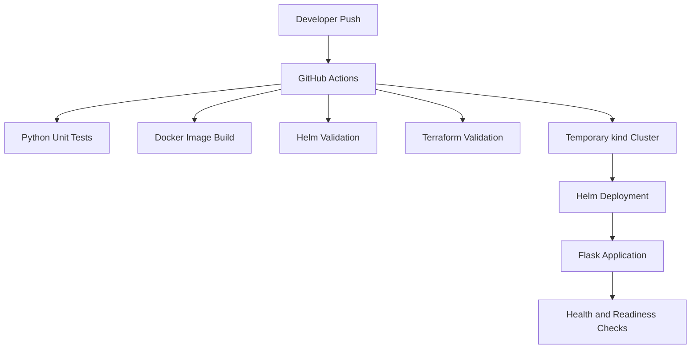

Infrastructure-as-Code Kubernetes Platform
A containerized Flask application deployed to Kubernetes using Helm and managed through Terraform, with GitHub Actions CI for automated validation and Kubernetes integration testing.
Architecture

Technology Stack
- Python, Flask, and Gunicorn
- Docker
- Kubernetes with kind
- Helm
- Terraform
- GitHub Actions
- Python unittest
Features
- Runs the application in a non-root container.
- Configures Kubernetes liveness and readiness probes.
- Supports configurable replicas, resource requests, and resource limits.
- Provides separate development and production Helm values.
- Restricts container privileges and drops Linux capabilities.
- Uses a read-only container root filesystem.
- Manages the Helm release with Terraform.
- Runs automated unit tests and configuration validation.
- Tests a temporary Kubernetes deployment and application endpoints in CI.
Project Structure
iac-kubernetes-platform/
├── .github/
│   └── workflows/
│       └── ci.yml
├── app/
│   ├── app.py
│   ├── Dockerfile
│   ├── requirements.txt
│   └── .dockerignore
├── helm/
│   └── platform-app/
│       ├── templates/
│       │   ├── deployment.yaml
│       │   └── service.yaml
│       ├── Chart.yaml
│       ├── values.yaml
│       ├── values-dev.yaml
│       └── values-prod.yaml
├── terraform/
│   ├── main.tf
│   └── .terraform.lock.hcl
├── tests/
│   └── test_app.py
├── .gitignore
└── README.md
Prerequisites
Install Docker Desktop, kind, kubectl, Helm, Terraform, Python 3.12 or later, and Git.

The local Kubernetes cluster is created separately. Terraform manages the Helm release, not the kind cluster itself.
Run Locally
1. Run unit tests
python -m pip install -r app/requirements.txt
python -m unittest discover -s tests -v
2. Build the application image
docker build -t iac-platform-app:1.0.1 ./app
3. Create or reuse the kind cluster
If the cluster does not already exist:
kind create cluster --name iac-platform
Load the application image into the cluster:
kind load docker-image iac-platform-app:1.0.1 --name iac-platform
kubectl get nodes
If the cluster already exists, reuse it instead of creating it again.
4. Deploy through Terraform
terraform -chdir=terraform init
terraform -chdir=terraform plan
terraform -chdir=terraform apply
Review the plan before approving the apply operation. Terraform manages the Helm release in the configured Kubernetes context.
5. Verify the deployment
kubectl rollout status deployment/platform-app -n platform-dev
kubectl get pods -n platform-dev
kubectl get service platform-app -n platform-dev
Forward the service to localhost:
kubectl port-forward service/platform-app 8080:80 -n platform-dev
In a second terminal, test the endpoints:
Invoke-RestMethod http://localhost:8080/
Invoke-RestMethod http://localhost:8080/healthz
Invoke-RestMethod http://localhost:8080/readyz
6. Validate Helm and Terraform
helm lint ./helm/platform-app
helm lint ./helm/platform-app -f ./helm/platform-app/values-dev.yaml
helm lint ./helm/platform-app -f ./helm/platform-app/values-prod.yaml

terraform -chdir=terraform fmt -check -recursive
terraform -chdir=terraform init -backend=false
terraform -chdir=terraform validate
CI Pipeline
The GitHub Actions workflow runs on pushes and pull requests targeting main or master, and can also be started manually.

It performs:
1. Python unit tests.
2. Docker image build.
3. Helm linting and template validation for default, development, and production values.
4. Terraform formatting and validation.
5. Creation of a temporary kind cluster.
6. Deployment using Helm.
7. Kubernetes rollout and HTTP endpoint checks.
Infrastructure Management
Terraform manages the platform-app Helm release in the platform-dev namespace. The kind cluster itself is managed separately.

Terraform state files and the local .terraform directory are excluded from Git. For shared or production environments, configure a secured remote state backend with locking where supported.
Cleanup
Remove the Terraform-managed Helm release first:
terraform -chdir=terraform destroy
After confirming that you no longer need the local cluster, delete it:
kind delete cluster --name iac-platform
Project Status
The Flask application, Docker image, local Kubernetes deployment, Helm chart, and Terraform-managed Helm release have been verified locally. Unit tests, Helm linting, Terraform validation, and the GitHub Actions workflow have passed.

The CI workflow validates the application and deploys it to a temporary kind cluster for integration testing. No cloud infrastructure is required for the current local setup.