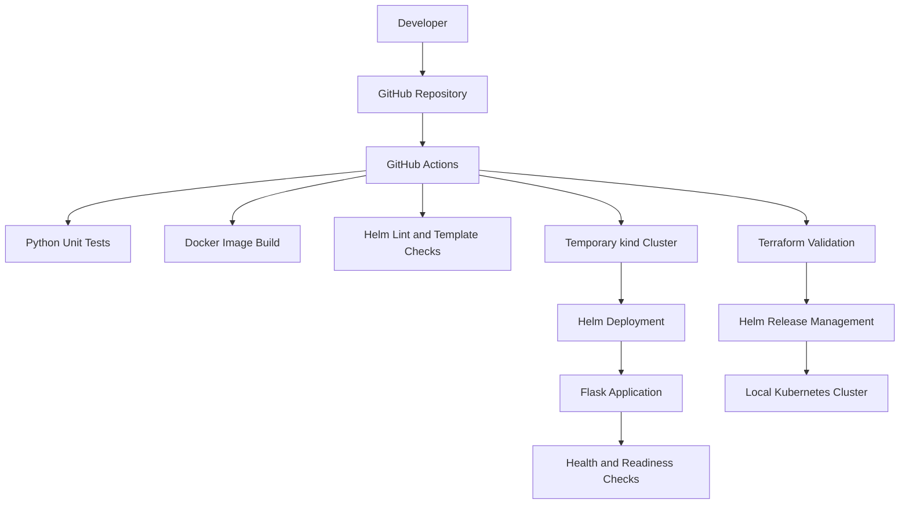

# Infrastructure-as-Code Kubernetes Platform


A containerized Flask application deployed to Kubernetes using Helm and managed through Terraform, with GitHub Actions CI for automated validation and Kubernetes integration testing.


## Architecture





## Technology Stack


\- Python, Flask, Gunicorn

\- Docker

\- Kubernetes with kind

\- Helm

\- Terraform

\- GitHub Actions

\- Python unittest


## Features


\- Non-root application container.

\- Liveness and readiness probes.

\- Configurable replicas and resource limits.

\- Separate development and production Helm values.

\- Restricted container privileges and dropped Linux capabilities.

\- Read-only container root filesystem.

\- Terraform-managed Helm release.

\- Automated unit tests and configuration validation.

\- Kubernetes deployment and endpoint verification in CI.


## Project Structure


```text

iac-kubernetes-platform/

├── .github/workflows/ci.yml

├── app/

├── helm/platform-app/

├── terraform/

├── tests/

├── .gitignore

└── README.md

```


## Prerequisites


Install Docker Desktop, kind, kubectl, Helm, Terraform, Python 3.12+, and Git.


The local Kubernetes cluster is created separately. Terraform manages the Helm release, not the kind cluster itself.


## Run Locally


### 1. Run unit tests


```powershell

python -m pip install -r app/requirements.txt

python -m unittest discover -s tests -v

```


### 2. Build the application image


```powershell

docker build -t iac-platform-app:1.0.1 ./app

```


### 3. Create or reuse the kind cluster


```powershell

kind create cluster --name iac-platform

kind load docker-image iac-platform-app:1.0.1 --name iac-platform

kubectl get nodes

```


If the cluster already exists, reuse it instead of creating it again.


### 4. Deploy through Terraform


```powershell

terraform -chdir=terraform init

terraform -chdir=terraform plan

terraform -chdir=terraform apply

```


Review the plan before approving changes.


### 5. Verify the deployment


```powershell

kubectl rollout status deployment/platform-app -n platform-dev

kubectl get pods -n platform-dev

kubectl get service platform-app -n platform-dev

```


Forward the service to localhost:


```powershell

kubectl port-forward service/platform-app 8080:80 -n platform-dev

```


In another terminal:


```powershell

Invoke-RestMethod http://localhost:8080/

Invoke-RestMethod http://localhost:8080/healthz

Invoke-RestMethod http://localhost:8080/readyz

```


### 6. Validate Helm and Terraform


```powershell

helm lint ./helm/platform-app

helm lint ./helm/platform-app -f ./helm/platform-app/values-dev.yaml

helm lint ./helm/platform-app -f ./helm/platform-app/values-prod.yaml


terraform -chdir=terraform fmt -check -recursive

terraform -chdir=terraform init -backend=false

terraform -chdir=terraform validate

```


## CI Pipeline


The GitHub Actions workflow is configured to run on pushes and pull requests targeting `main` or `master`, and through manual workflow dispatch.


It includes:


1\. Python unit tests.

2\. Docker image build.

3\. Helm lint and template validation.

4\. Terraform formatting and validation.

5\. Temporary kind cluster deployment.

6\. Kubernetes rollout and HTTP endpoint checks.


## Infrastructure Management


Terraform manages the `platform-app` Helm release in the `platform-dev` namespace. The kind cluster is managed separately.


Terraform state is excluded from Git. For shared or production environments, use a secured remote state backend with locking where supported.


## Cleanup


Remove the Terraform-managed Helm release first:


```powershell

terraform -chdir=terraform destroy

```


After confirming you no longer need the cluster:


```powershell

kind delete cluster --name iac-platform

```


## Current Status


The application, Docker image, local Kubernetes deployment, Helm chart, and Terraform-managed release have been verified locally. Unit tests, Helm linting, and Terraform validation pass.


The GitHub Actions workflow has been created. Its hosted CI and Kubernetes integration results still need to be confirmed after publishing the repository.
