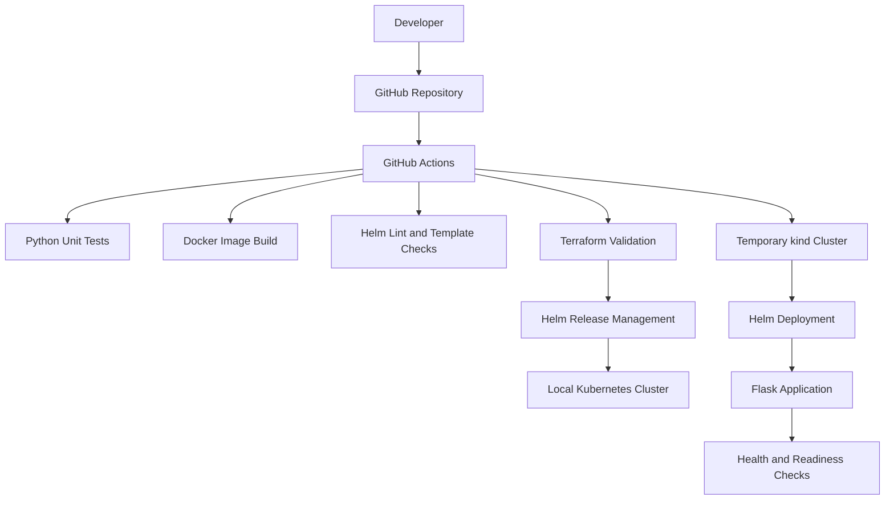

# Infrastructure-as-Code Kubernetes Platform

A containerized Flask application deployed to Kubernetes using Helm and managed through Terraform, with GitHub Actions CI for automated validation and Kubernetes integration testing.

## Architecture


## Technology Stack

| Technology | Purpose |
|---|---|
| Python and Flask | Application and HTTP endpoints |
| Gunicorn | Application server |
| Docker | Container image build |
| Kubernetes and kind | Local container orchestration |
| Helm | Kubernetes packaging and deployment |
| Terraform | Helm release management |
| GitHub Actions | CI automation |
| Python unittest | Application testing |

## Key Features

- **Infrastructure as Code:** Manage the Helm release using Terraform.
- **Container security:** Run as a non-root user with restricted privileges.
- **Health monitoring:** Configure Kubernetes liveness and readiness probes.
- **Resource management:** Configure CPU and memory requests and limits.
- **Environment configuration:** Maintain separate development and production Helm values.
- **Automated testing:** Run Python unit tests through CI.
- **Configuration validation:** Lint Helm charts and validate Terraform configuration.
- **Kubernetes integration testing:** Deploy to a temporary kind cluster and verify rollout and HTTP endpoints.

## Project Structure

```text
iac-kubernetes-platform/
├── .github/
│   └── workflows/
│       └── ci.yml
├── app/
│   ├── app.py
│   ├── Dockerfile
│   ├── requirements.txt
│   └── .dockerignore
├── helm/
│   └── platform-app/
│       ├── templates/
│       │   ├── deployment.yaml
│       │   └── service.yaml
│       ├── Chart.yaml
│       ├── values.yaml
│       ├── values-dev.yaml
│       └── values-prod.yaml
├── terraform/
│   ├── main.tf
│   └── .terraform.lock.hcl
├── tests/
│   └── test_app.py
├── .gitignore
└── README.md
```

## Prerequisites

Install the following tools:

- Docker Desktop
- kind
- kubectl
- Helm
- Terraform
- Python 3.12 or later
- Git

**Note:** Terraform manages the Helm release. The local kind cluster is created and managed separately.

## Run Locally

### 1. Run Unit Tests

From the project root:

```powershell
python -m pip install -r app/requirements.txt
python -m unittest discover -s tests -v
```

### 2. Build the Docker Image

```powershell
docker build -t iac-platform-app:1.0.1 ./app
```

### 3. Create or Reuse the kind Cluster

Create the cluster only if it does not already exist:

```powershell
kind create cluster --name iac-platform
```

Load the application image into the cluster:

```powershell
kind load docker-image iac-platform-app:1.0.1 --name iac-platform
kubectl get nodes
```

If the cluster already exists, reuse it instead of creating another one.

### 4. Deploy with Terraform

```powershell
terraform -chdir=terraform init
terraform -chdir=terraform plan
terraform -chdir=terraform apply
```

Review the execution plan before approving the apply operation.

### 5. Verify the Kubernetes Deployment

```powershell
kubectl rollout status deployment/platform-app -n platform-dev
kubectl get pods -n platform-dev
kubectl get service platform-app -n platform-dev
```

Forward the application service to localhost:

```powershell
kubectl port-forward service/platform-app 8080:80 -n platform-dev
```

Open a second terminal and test the endpoints:

```powershell
Invoke-RestMethod http://localhost:8080/
Invoke-RestMethod http://localhost:8080/healthz
Invoke-RestMethod http://localhost:8080/readyz
```

### 6. Validate Helm and Terraform

```powershell
helm lint ./helm/platform-app
helm lint ./helm/platform-app -f ./helm/platform-app/values-dev.yaml
helm lint ./helm/platform-app -f ./helm/platform-app/values-prod.yaml

terraform -chdir=terraform fmt -check -recursive
terraform -chdir=terraform init -backend=false
terraform -chdir=terraform validate
```

## CI Pipeline

The GitHub Actions workflow runs on pushes and pull requests targeting `main` or `master`. It can also be triggered manually.

### Job 1: Test and Validate

1. Install Python dependencies.
2. Run application unit tests.
3. Build the Docker image.
4. Lint and render Helm charts.
5. Check Terraform formatting and validate its configuration.

### Job 2: Kubernetes Deployment Test

1. Create a temporary kind cluster.
2. Build and load the application image.
3. Deploy the application using Helm.
4. Verify the Kubernetes rollout.
5. Test the health, readiness, and application version endpoints.

View workflow executions in [GitHub Actions](https://github.com/vinaykumar0710/iac-kubernetes-platform/actions).

## Infrastructure Management

Terraform manages the `platform-app` Helm release in the `platform-dev` namespace. The local kind cluster itself is managed separately.

Terraform state files and the local `.terraform` directory are excluded from Git.

For shared or production environments, configure a secured remote state backend and state locking where supported.

## Cleanup

Remove the Terraform-managed Helm release:

```powershell
terraform -chdir=terraform destroy
```

After confirming that the local cluster is no longer needed, delete it:

```powershell
kind delete cluster --name iac-platform
```

## Evidence

Screenshots demonstrating the project's successful deployment and validation are available in the [`evidence/`](evidence/) directory.

| Evidence | Description |
|---|---|
| [GitHub Actions](evidence/github-actions-success.png) | Successful CI and Kubernetes integration jobs |
| [Kubernetes Deployment](evidence/kubernetes-deployment.png) | Deployment rollout, pods, and service |
| [Application Health Checks](evidence/application-health-checks.png) | Application response, health, and readiness endpoints |
| [Terraform and Helm Validation](evidence/terraform-helm-validation.png) | Helm linting, Terraform validation, and no-change plan |

## Project Status

The Flask application, Docker image, local Kubernetes deployment, Helm chart, and Terraform-managed Helm release have been verified locally. Unit tests, Helm validation, Terraform validation, and the hosted GitHub Actions workflow have passed.

The integration workflow deploys the application to a temporary kind cluster and checks its rollout and HTTP endpoints.

**Environment:** Local Kubernetes; no paid cloud infrastructure required.